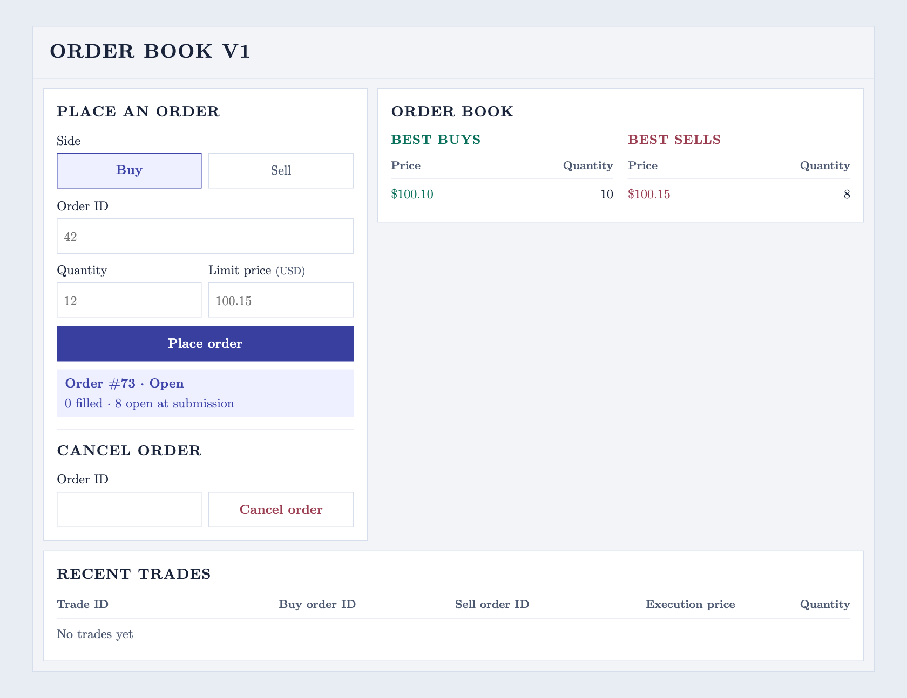
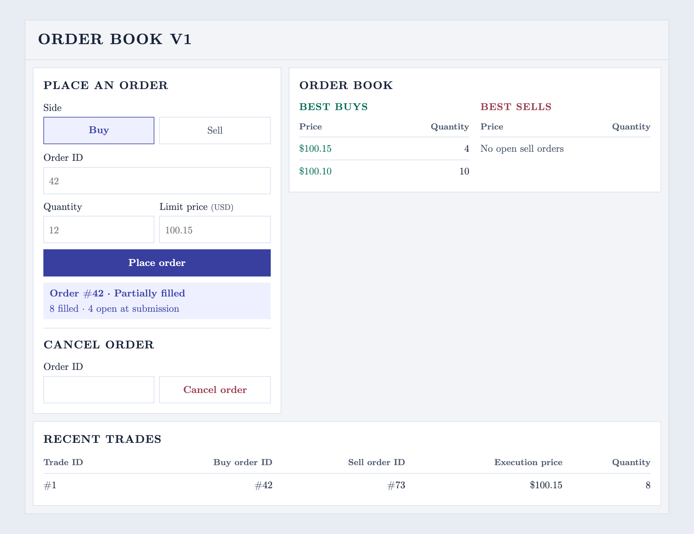

# Mini Exchange

Mini Exchange is a command-line C++ order-book simulator. It accepts limit buy
and sell orders, matches compatible orders using price-time priority, records
trades, supports cancellations, and prints the outstanding book.

## Rules

- Prices are integer cents internally; floating-point prices are never used.
- A buy order states the maximum price the buyer will pay.
- A sell order states the minimum price the seller will accept.
- A trade occurs when the best buy price is at least the best sell price.
- The highest-priced buy and lowest-priced sell have priority.
- Orders at the same price are processed in arrival order.
- A trade executes at the price of the resting order.

## Commands

Commands are read one per line from standard input.

```text
BUY <id> <price-in-cents> <quantity>
SELL <id> <price-in-cents> <quantity>
CANCEL <id>
PRINT
```

`id` is supplied by the caller and uniquely identifies an order for the life
of the book, including after it fills or is canceled. Trade IDs identify
executions separately. Canceling a filled, canceled, or unknown order leaves
the book unchanged.

Example input:

```text
SELL 1 10100 8
BUY 2 10100 3
BUY 3 10000 10
PRINT
```

Example output:

```text
TRADE: 3 shares at $101.00

SELL
$101.00 | 5

BUY
$100.00 | 10
```

`PRINT` displays outstanding quantity aggregated by price level: sells in
ascending price order, then buys in descending price order. Filled and
cancelled orders are omitted.

Both CLI formats use uppercase command names. The uncounted CLI reads
commands until end-of-input. The counted CLI starts with the number of
commands. In counted mode, `BUY` and `SELL` accept either
`<id> <price-in-cents> <quantity>` or `<price-in-cents> <quantity>`.
With two arguments, the engine assigns the order ID.

## Design

The book keeps a `std::list` of orders at each price level. Matching visits
buy levels from highest to lowest price and sell levels from lowest to highest
price. New orders join the back of their list, so matching from the front
preserves arrival order at each price.

### Eager vs. lazy cancellation

The original **lazy cancellation** marked an order inactive and left it in
the price queue. Matching discarded canceled orders when they reached the
front. A burst of cancellations could leave the next match with a long queue
of entries to skip.

With **eager cancellation**, each side has a `std::map` from order ID to its
list iterator. `CANCEL` finds the iterator and erases the order immediately.
Erasing a node takes constant time and preserves the iterators and relative
order of the other orders at that price. The ordered index and price lookups
give cancellation a logarithmic cost without scanning a price queue.

### Source layout

```text
CMakeLists.txt
benchmark/
  CMakeLists.txt
  benchmark_cancellation.cpp
include/
  command_parser.hpp
  matching_engine.hpp
  order.hpp
  order_book.hpp
media/
  web-buy-order.png
  web-sell-order.png
  web-trade.png
src/
  command_parser.cpp
  main.cpp
  matching_engine.cpp
  order_book.cpp
  web_engine.cpp
tests/
  CMakeLists.txt
  README.md
  data/
    ten_orders.txt
  engine_test_support.hpp
  matching_engine_replay.cpp
  matching_engine_test.cpp
  order_book_cli_test.cmake
  order_book_web_test.cmake
tools/
  order_replay.py
web/
  index.html
  server.py
  styles.css
```

## Build and run

The project requires a C++17 compiler and CMake 3.16 or newer.

```sh
cmake -S . -B build
cmake --build build
./build/order_book < orders.txt
```

## Web interface

Build the C++ adapter and start the local server with Python 3:

```sh
cmake -S . -B build
cmake --build build --target order_book_web
python3 web/server.py build/order_book_web
```

Open [Order Book V1](http://127.0.0.1:8000). The book starts empty and is held
in memory while the server runs. Try selling 8 shares at $100.15 with order ID
`73`, then buying 12 at the same price with order ID `42`. The buy receipt
shows 8 filled and 4 open. Recent Trades shows trade `#1` with buy order
`#42` and sell order `#73`. Enter `42` under **Cancel Order** to remove
the remaining 4 shares from Best Buys.

The [HTML form](web/index.html) posts the side, order ID, limit price, and
quantity to `/orders`. The [Python server](web/server.py) converts the price
to integer cents and sends `buy 42 10015 12` to the running
[C++ adapter](src/web_engine.cpp) over standard input. The cancel form posts
the order ID to `/cancel`, which sends `cancel 42` to the adapter. The
adapter invokes the engine and returns the result as JSON. The server
redirects back to the page and renders the five best price levels on each
side and the ten most recent trades.

### Example orders and trade

**Buy order.** Order `#41` adds a bid for 10 shares at $100.10.


**Sell order.** Order `#73` adds an ask for 8 shares at $100.15. Both orders
stay open because the buy limit is below the sell limit.



**Trade.** Buy order `#42` requests 12 shares at $100.15. It fills 8 against
order `#73`, leaving 4 open. The execution appears in Recent Trades.



## Tests

See the [testing guide](tests/README.md) for build commands, individual tests,
and instructions for generating and checking your own order files.

## Benchmarks

Build and run the benchmark in Release mode from the repository root.

```sh
cmake -S . -B build -DCMAKE_BUILD_TYPE=Release
cmake --build build --target benchmark
./build/benchmark/benchmark
```

The benchmark reports median times in microseconds across 11 trials per
workload size.

- **Buy/sell submissions** replays a fixed-seed batch on a fresh engine for
  each trial and measures the time to process the entire batch.
- **Cancellation burst** queues same-price sell orders, cancels all but the
  last, and measures the cancellation batch and the next matching buy
  separately.

### Results on MacBook Pro (Apple M4)

The `main` branch uses eager cancellation. The `lazy-cancellation-baseline`
tag points to commit `531c77d`, which contains the lazy implementation for
reproducing the comparison. Both implementations were benchmarked with the
same Release compiler flags.

#### Buy/sell submissions

| Orders | Lazy batch (µs) | Eager batch (µs) |
| ---: | ---: | ---: |
| 100 | 42.291 | 48.834 |
| 1,000 | 689.583 | 736.542 |
| 10,000 | 3,791.792 | 4,544.583 |
| 100,000 | 35,257.292 | 46,166.250 |
| 1,000,000 | 393,541.958 | 491,289.500 |

#### Cancellation burst

| Orders canceled | Lazy cancel batch (µs) | Eager cancel batch (µs) | Lazy next buy (µs) | Eager next buy (µs) |
| ---: | ---: | ---: | ---: | ---: |
| 100 | 2.708 | 3.667 | 1.667 | 0.125 |
| 1,000 | 37.375 | 39.417 | 19.041 | 0.125 |
| 10,000 | 431.375 | 421.000 | 178.834 | 0.208 |
| 100,000 | 8,356.166 | 4,836.208 | 2,048.291 | 1.167 |
| 1,000,000 | 115,704.750 | 62,291.334 | 29,079.792 | 2.041 |

The main benefit of eager cancellation is lower latency for the next buy.
It can reach the remaining sell immediately because `CANCEL` has already
removed the orders ahead of it. In the run above, the next buy went from
29.1 ms with lazy cancellation to about 2 µs with eager cancellation after
one million cancellations.

Cancel-batch timings vary with batch size and between runs. In the table,
the eager batch took longer at 100 and 1,000 cancellations and was faster at
larger sizes. A separate eager run took 147.7 ms at one million cancellations,
above the 115.7 ms lazy result shown here. The mixed submission batch also
took longer with eager cancellation, which maintains an iterator index as
orders arrive.

## Future work

After V1 is robust, possible extensions include CSV replay/import and trade
export, multiple symbols, amendments, and maximum quantity risk limits.
